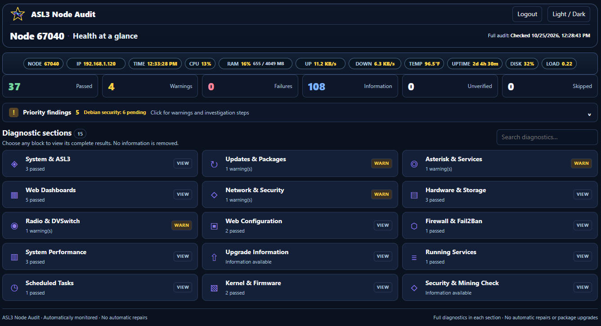
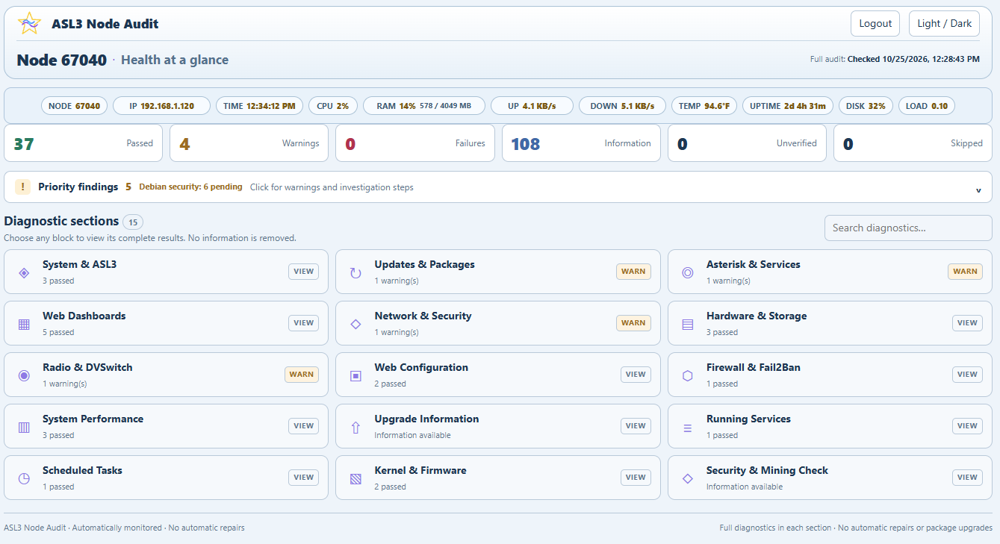

# ASL3 Node Audit

ASL3 Node Audit is a read-only diagnostic dashboard for an AllStarLink 3 node. It combines live system information with a scheduled 15-section audit covering ASL3, Asterisk, Debian packages, networking, security, storage, services, scheduled tasks, kernel/firmware, DVSwitch-related components, and other node health information.

It is a diagnostic tool. It does not automatically repair configuration, install upgrades, reboot the node, change radio settings, or modify other applications. Its scheduled security check does refresh Debian APT package metadata so update information stays current; it does not install or upgrade packages.

## What it provides

- 15 detailed diagnostic sections with PASS, WARN, FAIL, INFO, SKIP, and UNKNOWN results.
- Live CPU, RAM, network, temperature, uptime, disk, load, LAN IP, and local node information.
- Current Debian security-update information.
- Automatic local node detection from ASL3/Asterisk configuration.
- Dark and light display modes.
- Optional application login with a password-only login screen.
- A scheduled systemd monitor; no manual audit command is required for normal dashboard use.
- A version-aware header star. When a newer GitHub release is available, the star lights and pulses; hover shows the installed and available versions.

## Screenshots

<p align="center">
  <a href="screenshot-dark.png"></a>
</p>

<p align="center">
  <a href="screenshot-light.png"></a>
</p>

## Tested platform

Version 1.0.1 has been tested and is working on **AllStarLink 3 (ASL3) running Debian 13 (Trixie)**. It may also work on other ASL3/Debian releases, but those releases have not been verified for this version.

## Requirements

Before installing, the system should already have:

- a working ASL3 / app_rpt node;
- Apache and PHP;
- Python 3;
- Asterisk at `/usr/sbin/asterisk`;
- normal Debian APT repositories, including the matching Debian security repository;
- `curl`, `iproute2`, and standard systemd tools.

ASL3 Node Audit does not repair an incomplete ASL3 installation.

## First-time installation

```bash
cd /var/www/html
sudo git clone https://github.com/TerryClaiborne/asl3_node_audit.git asl3_node_audit
cd asl3_node_audit
sudo ./setup_asl3_node_audit.sh
```

Open:

```text
http://YOUR-NODE-IP-ADDRESS/asl3_node_audit/
```

HTTPS is recommended when the dashboard can be reached outside a trusted local network.

### Node detection

The installer follows the same basic detection model used by AllStar Connect:

1. `/etc/asterisk/savenode.conf` is checked first for one valid `NODE=` value.
2. If needed, `/etc/asterisk/rpt.conf` and its immediate `#include` files are checked.
3. Automatic detection is accepted only when exactly one 4-7 digit app_rpt node is identified.
4. An existing valid `MYNODE` value is preserved during updates.

If detection is not unambiguous, edit:

```text
/var/www/html/asl3_node_audit/config.ini
```

and set:

```ini
MYNODE="YOUR-NODE-NUMBER"
```

Then run setup again.

## Updating

```bash
cd /var/www/html/asl3_node_audit
sudo git pull origin main
sudo ./setup_asl3_node_audit.sh
```

Normal setup preserves the local node setting and saved application-password hash.

## Optional application login

A fresh installation starts with the application login disabled.

Set or change the administrator password and enable login:

```bash
sudo /var/www/html/asl3_node_audit/setup_asl3_node_audit.sh --set-admin-password
```

When setup or password configuration finishes, the installer prints the detected local dashboard URL, for example:

```text
http://YOUR-NODE-IP-ADDRESS/asl3_node_audit/
```

Open that address, click **Login**, and enter the administrator password. The login page asks for the password only.

Re-enable login using the saved password hash:

```bash
sudo /var/www/html/asl3_node_audit/setup_asl3_node_audit.sh --enable-auth
```

Disable login while preserving the saved password hash:

```bash
sudo /var/www/html/asl3_node_audit/setup_asl3_node_audit.sh --disable-auth
```

The configured administrator name is `admin`. The browser login page asks only for the password. Passwords are never stored in plaintext; the installer uses PHP `password_hash(..., PASSWORD_DEFAULT)`.

When login is enabled, signed-out users see the health-at-a-glance dashboard in **view-only mode**. Diagnostic section buttons, findings expansion, and search are disabled until Login succeeds. Login/Logout manages the optional administrator session. When authentication is disabled, the dashboard is fully interactive and no Login button is shown.

## Configuration

Local configuration is stored in:

```text
/var/www/html/asl3_node_audit/config.ini
```

The file is private, is not tracked by Git, and should remain `root:www-data` mode `0640`.

Example:

```ini
MYNODE=""
ASL3_NODE_AUDIT_AUTH_ENABLED=0
ASL3_NODE_AUDIT_ADMIN_USER="admin"
ASL3_NODE_AUDIT_ADMIN_PASSWORD_HASH=""
```

Do not place a plaintext password in `config.ini`.

## Security and permissions

The installer:

- exposes only `public/` through the `/asl3_node_audit` Apache Alias;
- denies direct HTTP access to `config.ini`, `src/`, `bin/`, and `run/`;
- keeps `config.ini` readable by PHP but not publicly served;
- keeps raw runtime snapshots root-only;
- publishes only sanitized dashboard feeds under protected `run/web/`;
- gives the web server write access only to the bounded login-rate-limit directory;
- runs the scheduled collector as a root systemd one-shot service;
- installs **no sudoers rules**;
- does not edit other applications' Apache configuration, virtual hosts, polling files, Fail2Ban, firewall, Asterisk, or DVSwitch configuration.

The Node Audit polling Apache file only sets a marker for this application's successful polling requests. It does not rewrite the host's shared `CustomLog` configuration.

## Uninstall

```bash
sudo /var/www/html/asl3_node_audit/setup_asl3_node_audit.sh --uninstall
```

Uninstall disables/removes only ASL3 Node Audit's systemd units and Apache configuration, reloads Apache after a syntax check, saves a protected copy of the application/config/runtime data under `/var/backups/asl3-node-audit/`, and then removes the application directory. It does not remove or rewrite other ASL3 applications.

## Project files

- `setup_asl3_node_audit.sh` - installation, update, authentication, and uninstall.
- `VERSION` - installed application version.
- `config.ini.example` - safe configuration template.
- `tree.txt` - ASCII map of the public repository layout.
- `public/` - dashboard pages and browser assets.
- `src/` - private PHP/Python application source.
- `bin/` - audit and scheduled-monitor programs.
- `run/` - generated private runtime state; never commit this directory.

## Troubleshooting

Validate Apache:

```bash
sudo apache2ctl configtest
```

Run the monitor once and inspect its result:

```bash
sudo systemctl start asl3-node-audit.service
systemctl show asl3-node-audit.service -p Result -p ExecMainStatus --no-pager
```

Check recent monitor messages:

```bash
journalctl -u asl3-node-audit.service -n 100 --no-pager
```

If `MYNODE` could not be detected, set it manually in `config.ini` and rerun setup. If the dashboard reports that security updates are unverified, run `sudo apt-get update` manually and inspect any repository errors before assuming the system is current.
